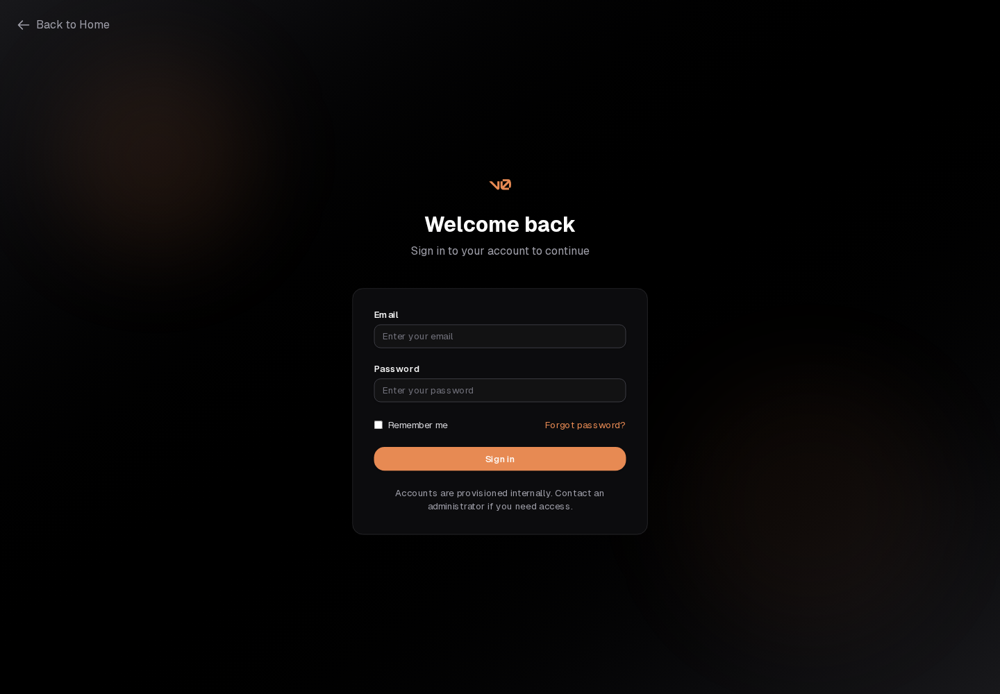

<h1 align="center">
  
  <br />
  Luma
</h1>

<h4 align="center">An API and operator console for script-based audio and video production.</h4>

<p align="center">
  
  
  
  
</p>

<p align="center">
  <a href="#demo">Demo</a> •
  <a href="#overview">Overview</a> •
  <a href="#key-features">Key Features</a> •
  <a href="#getting-started">Getting Started</a> •
  <a href="#how-to-use">How To Use</a> •
  <a href="#tests">Tests</a> •
  <a href="#credits-and-license">Credits and License</a>
</p>

## Demo

<p align="center">
  
</p>

<p align="center"><em>Signed-out login view captured from the tracked `/login` page. Both fields are empty, and the form was not submitted.</em></p>

## Overview

Luma contains a FastAPI service and a Next.js operator console. The code supports audio generation, avatar-video workflows, image-to-video tasks, longform audio scenes, and render assembly. These workflows call the external services that you configure for the project.

The console uses the InnerBhakti name in its sign-in and workspace screens. Accounts are provisioned by an administrator. The sign-up page does not create accounts.

## Key Features

- Generate per-scene and longform audio through the ElevenLabs routes.
- Create talking-avatar videos through the HeyGen routes.
- Submit image-to-video tasks through the Freepik routes.
- Upload scene images and assemble renders through the Creatomate routes.
- Use the console tabs for audio, video, image-to-video, render, longform scenes, and the audio library.
- Define Pydantic AI agents that use the OpenAI `gpt-5` model for workflow inputs.
- Store generated audio and assets in local directories that the API serves as static files.

The API protects workflow routes with bearer-token authentication. The login route uses a database account; the source has no self-service account creation flow.

## Getting Started

### Requirements

- Python 3.11 or newer. The root `.python-version` selects Python 3.13.
- `uv` for the Python project.
- Node.js and `pnpm` for the console. The repository does not pin their versions.
- A PostgreSQL database and a provisioned user for sign-in.
- Provider credentials for each external workflow you plan to use.

The root project uses `pyproject.toml` and `uv.lock`. The console uses `content-gen/package.json` and `content-gen/pnpm-lock.yaml`.

### Install

From the repository root:

```bash
uv sync
cp .env.example .env
```

Set `DATABASE_URL` and `JWT_SECRET_KEY` in `.env` before you start the API. Add the provider keys for the workflows that you will use. See [`.env.example`](.env.example) for the supported variable names. Do not commit `.env`.

Install the console dependencies:

```bash
cd content-gen
pnpm install --frozen-lockfile
```

### Run locally

Start the API from the repository root:

```bash
uv run python src/main.py
```

The source starts the API at `http://127.0.0.1:8002`. Its startup code connects to the configured database and creates the ORM tables. The API docs are at `http://127.0.0.1:8002/docs`.

In another terminal, start the console:

```bash
cd content-gen
pnpm dev
```

The console uses `http://127.0.0.1:8002/api/v1` by default. Set `NEXT_PUBLIC_API_BASE_URL` before `pnpm dev` if your API uses another address. Sign in with an account that an administrator has provisioned.

## How To Use

1. Configure the database and sign-in settings in `.env`.
2. Add the provider credentials for the workflow you plan to run.
3. Start the API and console.
4. Sign in with a provisioned account.
5. Open a console tab and submit a supported workflow.

Workflow requests can send scripts, images, or audio to the configured providers. Do not use sensitive input unless you are authorized to send it to those services.

## Tests

Run the Python tests and lint check from the repository root:

```bash
uv run pytest
uv run ruff check src
```

The console defines `lint` and `build` scripts, but no test script:

```bash
cd content-gen
pnpm lint
pnpm build
```

## Deployment

The tree includes a Vercel ASGI entry file at [`src/api/index.py`](src/api/index.py), plus [`src/requirements.txt`](src/requirements.txt) and [`src/runtime.txt`](src/runtime.txt). The runtime file says Python 3.11; the root development file selects Python 3.13. The tree has no tracked Vercel project configuration, Dockerfile, or deployment workflow, so it does not define the full deployment setup or its trigger.

## Credits and License

The source integrates OpenAI, ElevenLabs, HeyGen, Freepik, and Creatomate services. Their names belong to their respective owners.

The original README states **“Proprietary — Internal use only.”** No separate `LICENSE` file is tracked. This README preserves that restriction.

<hr />

<p align="center">
  <a href="src/main.py">API entry point</a> •
  <a href="content-gen/app/page.tsx">Operator console</a> •
  <a href="tests/">Python tests</a>
</p>
